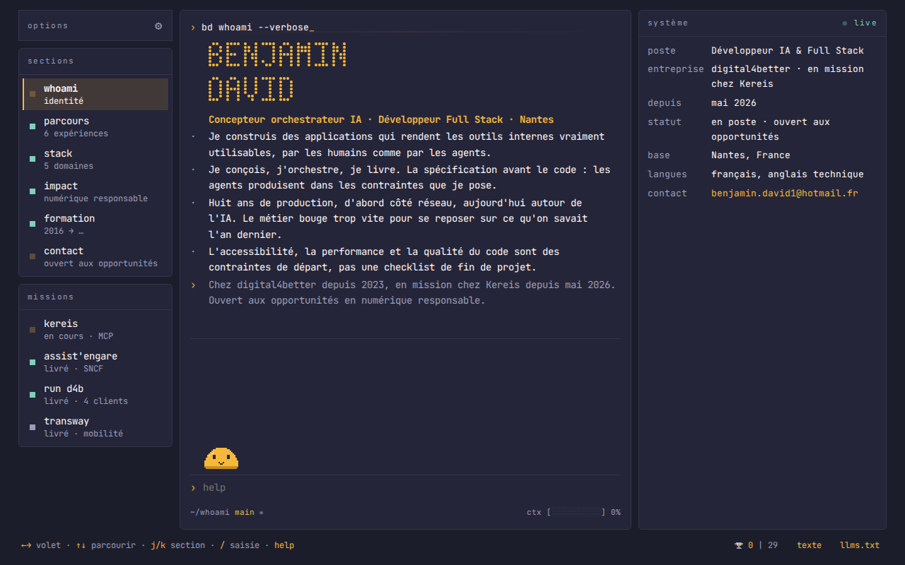

# Portfolio Benjamin David

[](https://github.com/Brezinben/portfolio/actions/workflows/tests.yml)

Le portfolio de Benjamin David prend la forme d'un terminal. Le visiteur tape des commandes ou navigue au clavier.
Une version texte existe aussi.

[Voir le site en ligne](https://me.brezinben.dpdns.org/)



## Licence

Le code est sous licence MIT : voir [`LICENSE`](LICENSE).
Les textes, les images et les polices ont d'autres conditions : voir [`NOTICE`](NOTICE).

## Démarrer

Installez les outils, puis les dépendances, puis le navigateur de test :

```
mise install
bun install
bun x playwright install chromium
```

`mise` fixe les versions des outils dans `.config/mise.toml`.

## Commandes

```
bun run build          # produit dist/ à partir de src/
bun run check          # format, lint, types, code mort, secrets, workflows
bun run test           # tests unitaires de l'interpréteur, sans navigateur
bun run test:browser   # tests de la page construite, dans Chromium
bun run test:mutation  # mutations Stryker sur l'interpréteur
bun run deps           # mise à jour interactive des paquets
```

Lancez `bun run test`, et non `bun test`. Sans `run`, Bun lance son propre lanceur, qui ramasse aussi `tests/browser/`.

Sur l'hôte `beta`, `bun run build` publie le site en ligne. Ailleurs, il ne publie rien.
Pour tester une construction, écrivez `PORTFOLIO_DIST=dist.test`.

## Pour aller plus loin

- [`AGENTS.md`](AGENTS.md) : les règles de travail du dépôt.
- [`CONTEXT.md`](CONTEXT.md) : le vocabulaire du projet.
- [`CONTEXT-MAP.md`](CONTEXT-MAP.md) : les deux contextes et leurs tests.
- [`docs/adr/`](docs/adr/) : les décisions d'architecture.
